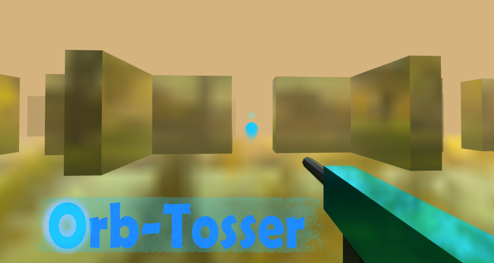

# Orb Tosser 2

Orb Tosser 2 is a browser based, first person arena shooter built with HTML, CSS, JavaScript, and Three.js. It is designed primarily for phones and tablets, with mobile touch controls and controller support. Play against bots on your own, or join the shared public multiplayer room.

## Contents

- [Play](#play)
- [How to play](#how-to-play)
- [Controls](#controls)
- [Game modes](#game-modes)
- [Settings](#settings)
- [Multiplayer](#multiplayer)
- [Run or publish the game](#run-or-publish-the-game)
- [Project files](#project-files)
- [About](#about)

## Play

Current version: [Play here](https://kevinw0w.github.io/Ultimate-Clicker-2.0.1/OrbshooterMobile/)

Older version: [Play here](https://kevinw0w.github.io/Ultimate-Clicker-2.0.1/OrbshooterMobile/Orb-TosserMobile.html)

Open `Orb-Tosser iOS12.html` in a supported mobile browser, or publish the project on GitHub Pages and open the published page. The game loads Three.js and PeerJS from CDNs, so an internet connection is needed for those libraries. Multiplayer also requires internet access.

From the title menu:

- Choose **PLAY** to join the shared multiplayer game, then choose a game mode and weapon.
- Choose **PLAY WITH BOTS** to start a solo match against bots. Solo matches do not connect to multiplayer and allow the Nuke Launcher.

The game starts after you select a weapon. On mobile, use the on-screen controls. On desktop, the game displays a mobile-only notice; the built-in desktop debug mode is intended for development, not normal play.

## How to play

Move around the city arena, aim at opponents, and shoot to score. Watch your health and ammunition displays. Reload when needed. When eliminated, choose **RESPAWN (KEEP LOADOUT)** or select a different weapon. Use the pause menu to resume, change settings, restart the match, or return to the title menu.

The weapon selection screen offers the available loadouts. The game also includes weapon progression for Gun Game, team scoring, flags in Capture the Flag, and a leaderboard. Match rules depend on the selected mode.

## Controls

### Touchscreen

- **Move stick:** Move forward, backward, and side to side.
- **Swipe the screen:** Look and aim.
- **FIRE:** Shoot or throw a charged knife.
- **AIM:** Aim down sights; with a melee weapon, hold to charge a knife throw.
- **JUMP:** Jump.
- **SLIDE:** Slide while sprinting, or crouch when a slide cannot start.
- **SPRINT:** Toggle sprint.
- **RELOAD:** Reload the current weapon.
- **SWAP:** Change weapon.
- **PAUSE:** Open the pause menu.

The **Edit Mobile Layout** setting lets you move and resize the touch controls. Positions are saved on the device. Choose **RESET** in the layout editor to restore the default positions.

### Keyboard and mouse

Keyboard and mouse controls are available in the desktop debug mode:

- **W/A/S/D:** Move.
- **Mouse:** Aim.
- **Left mouse button:** Fire.
- **Right mouse button:** Aim; hold with a melee weapon to charge a knife throw.
- **Space:** Jump and deploy from the loadout screen.
- **Shift:** Sprint.
- **C:** Crouch or slide while sprinting.
- **R:** Reload.
- **1 / 2 / 3:** Select weapon slot.
- **Q:** Cycle weapon.
- **Escape:** Pause or release pointer lock.

Control bindings can be changed in **Settings → Control Map**.

### Game controller

Connect a gamepad before or during play. The default mapping follows a standard controller layout: left stick moves, right stick aims, right trigger fires, left trigger aims, A jumps, X reloads, bumpers switch weapons, and Start pauses. Use **Settings → Control Map** to remap buttons. Controller menu navigation is available on the title, loadout, pause, and settings screens.

## Game modes

- **Free For All:** Every player competes individually.
- **Team Deathmatch:** Red and blue teams compete for eliminations.
- **Capture the Flag:** Teams try to take the opposing flag and return it to their base.
- **Gun Game:** Eliminations advance players through a weapon sequence.

The game also has a configurable bot count. Bot settings are available in **Settings**.

## Settings

Settings are saved in the browser on the current device. Available options include:

- **Player Name:** Sets your name in multiplayer and on the leaderboard. Human players appear blue.
- **Sensitivity / Controller Sens:** Adjust look speed.
- **FOV:** Adjust the camera field of view.
- **Bot Count:** Change the number of bots in a match.
- **Aim Snap / Absolute Aim:** Tune aim assistance and controller aiming behavior.
- **Low Power Mode / Auto Graphics / Render Scale:** Adjust graphics performance and render resolution.
- **Show FPS / Show Crosshair / Disable Post-Processing:** Change display and visual effects.
- **Frame Rate:** Toggle the 30 FPS limit.
- **Sprint, crouch, aim, and slide options:** Choose toggle or hold behavior where available.
- **Mobile Auto Aim / Mobile Auto Shoot:** Enable optional touch aim assistance.
- **Glossy Sky, BGM Track, and Music Vol:** Change visuals and music.
- **Control Map:** Remap keyboard or gamepad controls.
- **Edit Mobile Layout:** Reposition and resize touch controls.

The **Nuke Launcher** is solo-only. It is disabled in multiplayer, and the game blocks it from firing while a multiplayer match is active.

## Multiplayer

The game automatically joins the shared room named `main` when you choose **PLAY**. There is no room code or manual connection button. Set your name in **Settings**; it is saved locally and can be changed during play. Multiplayer is peer-to-peer: PeerJS Cloud provides signaling, while gameplay data is sent over WebRTC data channels. Human player names appear blue on the leaderboard; bot names appear white.

GitHub Pages can host the static game files, but it does not provide a multiplayer game server. In the current peer hosted setup, the first player in the room relays game updates and is the temporary host. The room supports up to eight players. If the host leaves, connected players are disconnected and someone must start a new room session. Some restrictive networks may also prevent WebRTC connections because this setup does not configure a TURN relay.

See [MULTIPLAYER.md](MULTIPLAYER.md) for the multiplayer details and current limitations.

## Run or publish the game

### Run a local copy

1. Keep the HTML file, JavaScript engines, service worker, manifests, and image/icon assets together in the same folder.
2. Open `Orb-Tosser iOS12.html` in a mobile browser.
3. Choose **PLAY WITH BOTS** for a local solo match. For multiplayer, the browser must be able to access the internet and PeerJS/WebRTC.

Some browser features, especially service workers, require HTTPS or localhost. A `file://` copy can be used for local play, but it does not install as a PWA through the service worker.

### Publish on GitHub Pages

1. Commit the project files to a GitHub repository.
2. In the repository, open **Settings → Pages**.
3. Select the branch and folder containing `Orb-Tosser iOS12.html` and the rest of the assets, then save.
4. Open the published Pages URL on a phone or tablet. If an older copy persists, reload after the service worker updates its cache.

Keep the following files together when publishing:

- `Orb-Tosser iOS12.html`
- `Engine Ai Bots.js`
- `Engine Ai Multiplayer.js`
- `service-worker.js`
- `manifest-older.webmanifest` and `manifest.webmanifest`
- `icon.ico`, `icon.png`, `touchicon.png`, and `og-thumbnail.png`

## Project files

| File | Purpose |
| --- | --- |
| `Orb-Tosser iOS12.html` | Main game, interface, input, rendering, and gameplay logic. |
| `Engine Ai Bots.js` | Bot movement and AI routines loaded by the main HTML page. |
| `Engine Ai Multiplayer.js` | PeerJS/WebRTC multiplayer transport and message relay. |
| `MULTIPLAYER.md` | Multiplayer setup and architecture notes. |
| `service-worker.js` | Offline app shell caching for supported HTTPS/localhost installs. |
| `manifest.webmanifest` | Main installable web app metadata. |
| `manifest-older.webmanifest` | Manifest referenced by the iOS 12 game page. |
| `icon.*`, `touchicon.png`, `og-thumbnail.png` | App icons and sharing preview. |

## About

Orb Tosser 2 is a self-contained browser game project with a Three.js 3D city arena, local bot matches, mobile touch controls, controller support, several weapon types, and optional peer-to-peer multiplayer. It is designed to run as a static website, including on GitHub Pages. Multiplayer is experimental and relies on players to host and relay each room session.
